# Database ER Diagram

```mermaid
erDiagram
    auth_users ||--|| profiles : "1:1"
    profiles ||--|| user_settings : "1:1"
    profiles ||--|| user_privacy_settings : "1:1"
    profiles ||--o{ admin_roles : "has"

    profiles }|--o{ follows : "follower"
    profiles }|--o{ follows : "following"
    profiles }|--o{ follow_requests : "requester"
    profiles }|--o{ follow_requests : "target"
    profiles }|--o{ blocked_users : "blocker"
    profiles }|--o{ blocked_users : "blocked"
    profiles }|--o{ muted_users : "muter"
    profiles }|--o{ muted_users : "muted"

    profiles ||--o{ posts : "author"
    posts }|--o{ post_media : "has"
    media }|--o{ post_media : "in"
    profiles ||--o{ media : "owner"
    posts }|--o{ post_likes : "liked_by"
    profiles }|--o{ post_likes : "liker"
    posts }|--o{ post_reactions : "reacted_by"
    profiles }|--o{ post_reactions : "reactor"
    posts }|--o{ comments : "has"
    profiles ||--o{ comments : "author"
    comments }|--o{ comment_likes : "liked_by"
    profiles }|--o{ comment_likes : "liker"
    comments }|--o{ comment_reactions : "reacted_by"
    profiles }|--o{ comment_reactions : "reactor"
    posts }|--o{ post_shares : "shared_by"
    profiles }|--o{ post_shares : "sharer"
    profiles }|--o{ bookmarks : "bookmarker"
    posts }|--o{ bookmarks : "bookmarked"
    posts }|--o{ post_hashtags : "tagged"
    hashtags }|--o{ post_hashtags : "in"
    posts }|--o{ mentions : "mentions_in"
    comments }|--o{ mentions : "mentions_in"
    profiles }|--o{ mentions : "mentioned"

    profiles ||--o{ stories : "author"
    stories }|--o{ story_media : "has"
    media }|--o{ story_media : "in"
    stories }|--o{ story_views : "viewed_by"
    profiles }|--o{ story_views : "viewer"
    stories }|--o{ story_reactions : "reacted_by"
    profiles }|--o{ story_reactions : "reactor"

    posts ||--|| polls : "has"
    polls }|--o{ poll_options : "has"
    poll_options }|--o{ poll_votes : "voted_on"
    profiles }|--o{ poll_votes : "voter"

    profiles ||--o{ conversations : "creator"
    conversations }|--o{ conversation_members : "has"
    profiles }|--o{ conversation_members : "member"
    conversations }|--o{ messages : "has"
    profiles ||--o{ messages : "sender"
    messages }|--o{ message_attachments : "has"
    media }|--o{ message_attachments : "in"
    messages }|--o{ message_reactions : "reacted_by"
    profiles }|--o{ message_reactions : "reactor"
    messages }|--o{ message_read_receipts : "read_by"
    profiles }|--o{ message_read_receipts : "reader"

    profiles ||--o{ notifications : "recipient"
    profiles ||--|| notification_preferences : "has"
    profiles }|--o{ push_subscriptions : "has"

    profiles }|--o{ reported_content : "reporter"
    profiles }|--o{ reported_content : "moderator"
    profiles }|--o{ moderation_actions : "moderator"
    profiles }|--o{ moderation_actions : "target_user"
    profiles }|--o{ audit_logs : "actor"
    profiles }|--o{ admin_roles : "granted_by"

    media }|--o{ media_processing_jobs : "has"
    profiles }|--o{ media_upload_sessions : "initiated"
    media }|--o{ media_upload_sessions : "results_in"
    profiles ||--|| storage_usage : "has"

    profiles }|--o{ search_history : "searcher"
    hashtags }|--o{ trending_hashtags : "trending"
    posts }|--o{ post_views : "viewed_by"
    profiles }|--o{ post_views : "viewer"

    profiles }|--o{ platform_settings : "updated_by"
```

## Key Tables Summary

### Core (3)
- `profiles` - User profiles linked to Supabase Auth
- `user_settings` - UI/theme preferences
- `user_privacy_settings` - Privacy controls

### Social Graph (4)
- `follows` - Follow relationships (PK: follower_id, following_id)
- `follow_requests` - Private account requests
- `blocked_users` - Block relationships
- `muted_users` - Mute relationships

### Content (13)
- `posts` - All post types (text, image, video, audio, file, service, product, vacancy, job, poll)
- `media` - R2 metadata (id, owner_id, type, r2_key, r2_bucket, filename, mime_type, size, dimensions)
- `post_media` - Junction table
- `post_likes`, `post_reactions` - Post interactions
- `comments` - Comments & replies (self-ref via parent_comment_id)
- `comment_likes`, `comment_reactions` - Comment interactions
- `post_shares` - Share tracking
- `bookmarks` - Saved posts
- `hashtags` - Normalized tags with post_count
- `post_hashtags` - Junction
- `mentions` - @mentions in posts/comments

### Ephemeral (5)
- `stories` - 24h content
- `story_media`, `story_views`, `story_reactions`

### Polls (3)
- `polls`, `poll_options`, `poll_votes`

### Messaging (6)
- `conversations` - DM/group
- `conversation_members` - Participants with roles
- `messages` - Content with types
- `message_attachments`, `message_reactions`, `message_read_receipts`

### Notifications (3)
- `notifications`, `notification_preferences`, `push_subscriptions`

### Moderation/Admin (4)
- `reported_content`, `moderation_actions`, `audit_logs`, `admin_roles`

### System (7)
- `platform_settings`, `media_processing_jobs`, `media_upload_sessions`, `storage_usage`, `search_history`, `trending_hashtags`, `post_views`

## Critical Indexes
- `posts(author_id, created_at)` - Feed queries
- `profiles(username)` UNIQUE, `profiles(display_name)` GIN trigram
- `follows(follower_id)`, `follows(following_id)`
- `comments(post_id, created_at)`
- `messages(conversation_id, created_at)`
- `posts.search_vector` GIN, `profiles.search_vector` GIN
- `notifications(user_id, is_read, created_at)`

## RLS Principles
- Own data + public + authorized private
- Blocks/mutes enforced at DB level
- Admins bypass via `is_admin_or_moderator()`
- Service role for system ops only